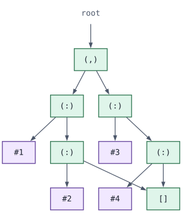
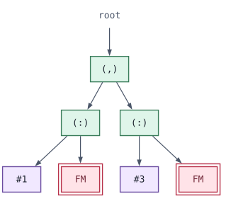

## Introduction

I recently finished [my PhD thesis](../../papers/phd-thesis.pdf), which includes a background chapter on distributed Haskell.
This post is that chapter, edited to stand on its own.
It is a survey in the loose sense: I cover the systems that mattered for my thesis, not every system ever built.
Notably, some (read: one) system is not a Haskell system at all, but a Haskell-_inspired_ system.

Haskell systems distribute computation for one of two reasons.
Some want to speed up a single computation by spreading it over several cores or machines.
Others describe applications whose components must run in different places, close to particular devices, data, or services.
The two aims lead to different programming models, but they face many of the same problems, so this post covers both.

One problem runs through every system: when work moves from one machine to another, what actually moves?
Moving the data a computation needs is comparatively easy.
Moving the code that computes with it is much harder, and the systems below solve it differently, or not at all.

The story is roughly chronological, starting with GUM in the mid-1990s and ending with Cloud Haskell, HdpH, and Unison.
Some systems get more space than others, usually because a distinguishing feature needs careful explanation.

I assume you know how lazy functional languages are typically compiled, in particular that a running program is represented as a graph of heap closures and thunks.

## Distributed Haskell

Distributed Haskell systems pursue two distinct aims.
One is to accelerate a single computation by evaluating parts of it across several processors or machines.
The other is to describe an application whose components must execute at different locations, for example close to particular devices, data, or services.
These aims lead to different programming models: distributed evaluation in the former case, and independently communicating components in the latter.
The challenges both parallel and distributed Haskell systems must solve significantly overlap, so this post discusses both parallel and distributed Haskell systems.

We use the systems below to examine four recurring design questions.
What are the independently executing units, who decides where they run, what information can move between them, and which part of the language implementation provides that mobility?

### GUM

GUM is a portable parallel implementation of Haskell presented by Trinder et al. [@DBLP:conf/pldi/TrinderHMPJ96].
It extends the STG runtime with a collection of logical processing elements (PEs), which may be mapped to processors on either shared- or distributed-memory machines.
Each PE maintains its own local heap and schedules a pool of Haskell threads.
Together, these local heaps implement a global virtual heap containing the program's shared graph.

When evaluation on one PE demands an object owned by another, the runtime requests it from the owning PE.
Rather than returning only the requested object, the owning PE also packs a bounded portion of the nearby reachable graph.
This bulk transfer amortises communication latency by reducing the likelihood of another remote request.
When the packet boundary cuts an edge in the graph, the omitted target is represented by a Fetch-Me node, as illustrated below.
If that node is subsequently demanded, GUM retrieves the missing graph fragment from its owning PE.

```{=html}
<figure>
<div class="subfigures">
<figure>

<figcaption>(a) The full subgraph reachable from the requested root on the owning PE.</figcaption>
</figure>
<figure>

<figcaption>(b) The bounded graph packet sent to the requesting PE.</figcaption>
</figure>
</div>
<figcaption>Graph packing in GUM. The full subgraph reachable from the requested root (a) is truncated to form a bounded transfer packet (b). Edges crossing the packet boundary are replaced by Fetch-Me (FM) nodes, allowing the omitted subgraphs to be retrieved later if demanded.</figcaption>
</figure>
```

GUM transfers heap closures and their relationships, but it does not transfer executable code.
The closures describe the current state of a computation while referring to code already available to every PE.
GUM therefore moves work and data within a common compiled program, rather than providing code mobility between independently deployed programs.

GUM is important here because it demonstrates that a distributed runtime can move the state of a lazy computation by operating directly on its heap graph.
It also exposes a central limitation that will recur throughout this post, that moving a graph of closures is not the same as moving the executable code to which those closures refer.

### Glasgow Distributed Haskell

While GUM achieved true parallelism by running multiple PEs, a single Haskell thread still drove the evaluation, with the runtime system using additional PEs to accelerate it when possible.
A related line of work is that of Concurrent Haskell [@DBLP:conf/popl/JonesGF96], which focused on concurrent programming primitives for Haskell.
Its implementation used just one PE to run multiple threads, which communicated via messaging primitives such as `MVar`s.
We will not elaborate much on Concurrent Haskell, but mention it here to form a segue to Glasgow Distributed Haskell (GdH) [@DBLP:conf/ifl/PointonTL00].

GdH built on the results of both the GUM runtime and Concurrent Haskell.
It retained GUM's multiple PEs and added a thread vocabulary much like that of Concurrent Haskell.
The GUM runtime was extended with support for talking about the PEs of a running program, and creating threads on them.
The cornerstones of the GdH API are facilities for identifying underlying PEs at runtime and creating threads on distant PEs.
Furthermore, some resources must remain at a particular PE, so the `Immobile` type class can identify which PE owns a particular resource.

```haskell
myPEId :: IO PEId
allPEId :: IO [PEId]

rforkIO :: IO () -> PEId -> IO ThreadId
revalIO :: IO a -> PEId -> IO a

class Immobile a where
  owningPE :: a -> IO PEId
```

Notably, a thread on one PE can spawn a thread on another PE.
The `MVar`s of Concurrent Haskell were extended to work across the multiple PEs of GUM and were the primary mechanism by which threads exchanged data.
As an example, the below program queries the runtime for all available PEs and spawns a thread on the first one using `rforkIO`.
The main thread then waits until the created thread populates the `MVar`, at which point it reads its value and prints it.

```haskell
main = do
  p:ps <- allPEId
  m <- newEmptyMVar
  rforkIO (putMVar m 42) p
  r <- takeMVar m
  putStrLn (show r)
```

As GdH built upon the GUM runtime, it inherited its characteristics.
Code never actually crosses between PEs, and all PEs are loaded up with the same compiled executable.
In the above example, the body of the created thread is represented by a closure that models the applications involved, but the code for actually evaluating, e.g., `putStrLn`, is not sent between PEs.

### Eden

Eden [@DBLP:journals/jfp/LoogenOP05] is another Haskell implementation for distributing evaluation.
It takes a different approach to the implicit distribution of the GUM runtime, and to the explicit thread vocabulary of GdH.
Eden provides _processes_, which are remotely instantiated functions from `a` to `b`.
The core API is, once again, quite small.

```haskell
class NFData a => Trans a where (...)
data (Trans a, Trans b) => Process a b = ...

process :: (Trans a, Trans b) => (a -> b) -> Process a b
( # )   :: (Trans a, Trans b) => Process a b -> a -> b

type ChanName a = ...
new     :: Trans a => (ChanName a -> a -> b) -> b
parfill :: Trans a => ChanName a -> a -> b -> b
```

A `Process a b` type models a process that takes a value of type `a` as input and returns a value of type `b`.
Processes are declared via `process`, but actually started by `#`, which applies it to its input.
Channels can be used to send data between arbitrary processes, using the `new` and `parfill` functions.

Eden separates three distinct things.
Computations themselves are expressed as ordinary Haskell functions.
The process abstraction is created with `process`, and finally the parallel instantiation is performed with `(#)`.
The type class `Trans` is instantiated by every type that can cross between processes.
The `NFData` constraint is used to ensure that values are evaluated before being communicated.
Because an Eden process takes an input and produces an output when it terminates, it implicitly communicates with its parent process.
However, for dynamic communication with arbitrary processes a user must create named channels with `new` and write to them with `parfill`.
A restriction on channels is that they can only be used _once_.
Subsequent writes to the same channel result in an error.

Reading from a channel is done implicitly.
A process that creates a channel might execute

```haskell
new (\chanName val -> body)
```

While not obvious, `body` now has access to _both_ the write-end and read-end of the channel.
`chanName` can be used by any process to send a value down the channel.
A process might write to the channel like so:

```haskell
parfill chanName x cont
```

`parfill` creates a concurrent thread that evaluates `x` and sends it down the channel, while the current process immediately continues with `cont`.
The read-end of the channel is the value `val :: a`.
It is a lazy placeholder for a value that might arrive through the channel at some point.
Trying to force `val` will block that process until the value arrives.

### Mobile Haskell

GdH and Eden give the programmer more explicit ways to describe remote activity and communication than GUM.
Nevertheless, they retain the same basic deployment assumption: computation may be placed remotely, but the code required to perform it must already be installed there.
The next question is therefore whether a Haskell system can move not only the state of a computation, but also the code required to continue it.
_Mobile Haskell_ (mHaskell) [@DBLP:conf/sfp/BoisTL03] explores this possibility.
It extends Concurrent Haskell with higher-order communication channels called `MChannel`s.
An `MChannel` can transmit Haskell values, including functions, `IO` actions, and other channels.
Channels can be registered by name and discovered by independently executing programs, allowing mHaskell to support open distributed systems rather than only a fixed collection of processing elements.
Remote evaluation is implemented by sending an `IO` action through such a channel and starting it on the receiving machine.

The interface for remote evaluation is particularly direct:

```haskell
rforkIO :: IO () -> HostName -> IO ()

greet :: HostName -> String -> IO ()
greet host name = rforkIO (putStrLn ("Hello, " ++ name)) host
```

The action passed to `rforkIO` closes over `name`.
mHaskell serialises the graph representing this action, including the captured string and any required mobile bytecode, and reconstructs it on `host`.
References to native code, such as library routines used by `putStrLn`, are instead resolved against code already installed at the receiving machine.

mHaskell is implemented as an extension of GHC.
It was designed for heterogeneous networks whose machines may use different processor architectures and operating systems.
Its runtime extensions are implemented in portable C, with communication between machines implemented using TCP sockets.
To make executable code portable between architectures, mHaskell combines native code produced by GHC with machine-independent bytecode produced by GHCi.

Modules compiled by GHCi are represented by ByteCode Objects and can be included in a transmitted graph.
Modules compiled to native code are not transmitted and must instead be available for linking at the destination.
By compiling shared modules to native code and potentially mobile modules to bytecode, the programmer controls how much code is transmitted and how much must already be installed at each node.

To serialise a computation, mHaskell adapts GUM's graph-packing algorithm and extends it to recognise ByteCode Objects.
Unlike GUM, which may terminate a graph packet with Fetch-Me nodes referring back to the source PE, mHaskell continues until the entire graph reachable from the transmitted value has been serialised.
Sharing and cycles within that graph are preserved, but no references back into the sender's heap remain.
The receiver therefore obtains an independent copy rather than participating in a global shared heap.

mHaskell's mobility therefore depends on a shared software base.
Participating machines must run compatible versions of the modified GHC runtime and provide any native libraries required by received bytecode.
Furthermore, any user-defined data types used by a transmitted computation must already have compatible compiled definitions at the receiving machine, since the prototype transmits their values but not their definitions.

mHaskell demonstrates that code mobility is possible when the transferred representation includes portable bytecode.
Its implementation also depends directly on GHC's internal representations of heap closures, ByteCode Objects, and linker information.
This illustrates the engineering cost of implementing distribution inside a large and evolving compiler runtime.

### Cloud Haskell

GdH, Eden, and mHaskell all obtain their distributed behaviour through specialised compiler or runtime support.
Cloud Haskell explores a different point in the design space by implementing distributed coordination primarily as a library on top of an ordinary GHC runtime.

_Cloud Haskell_ [@DBLP:conf/haskell/EpsteinBJ11] is a shallowly embedded domain-specific language for distributed programming on an ordinary GHC runtime.
It follows Erlang's model of lightweight processes that communicate by passing messages rather than through shared memory.
A _node_ represents a participating runtime system at a particular network location.
Each node can execute many concurrent processes, and each process has a process identifier and a mailbox.
Processes can create further processes locally or remotely, exchange messages, and monitor one another for termination.

The types of the basic message-passing operations expose an important restriction:

```haskell
send   :: Serializable a => ProcessId -> a -> ProcessM ()
expect :: Serializable a => ProcessM a
```

A value sent between processes must satisfy the `Serializable` constraint, which provides the binary representation needed to transmit it.
Function values present a particular difficulty because a function's type describes only its argument and result, not the environment captured by that function.
A closed function and a function of the same type that captures an `Int` may both have type `Int -> Int`, while a third function of that type might capture another function.
Their types are identical, but their environments have different serialisation requirements.
Consequently, whether a function can be serialised cannot be determined structurally from its type.

Cloud Haskell addresses the code part of this problem by introducing the type `Static a`.
The proposed typing rule distinguishes top-level bindings, which are classified as static, from locally bound variables, which are classified as dynamic.
An expression `static e` is accepted only when every free variable of `e` refers to a static, top-level binding.
It may therefore refer to other top-level definitions, but it cannot capture a value bound by a surrounding function or local `let`.
A top-level supercombinator, meaning a function with no dynamically bound free variables, is the simplest example of such a static expression, although the rule also permits expressions composed from several top-level definitions.

Under Cloud Haskell's assumption that participating nodes run the same program, a static function can be represented by a symbolic code label.
The receiving node can use that label to locate its own copy of the function.
A value of type `Static a` is therefore serialisable without requiring `a` itself to satisfy `Serializable`.
The static machinery does not make an arbitrary captured environment serialisable; instead, it guarantees that the code component has no hidden dynamic environment.

Remote process creation makes this boundary visible in its type:

```haskell
spawn :: NodeId -> Closure (ProcessM ()) -> ProcessM ProcessId
```

The caller explicitly chooses the destination node, but cannot pass an arbitrary `ProcessM ()` action.
Instead, the action must be represented by a value of type `Closure (ProcessM ())`.

The word _closure_ requires some care here.
The GHC heap closures discussed earlier in this post are low-level runtime objects representing functions, applications, constructors, thunks, and other heap values.
Cloud Haskell's `Closure a` is not an exposed GHC heap closure.
It is an explicitly constructed, source-level Haskell value that describes how a value of type `a` can be reconstructed on another node.
Cloud Haskell serialises this description rather than traversing and copying the arbitrary runtime graph reachable from the original value.

Conceptually, Cloud Haskell uses the following representation:

```haskell
data Closure a where
  MkClosure :: Static (ByteString -> a) -> ByteString -> Closure a
```

The two fields separate the statically identifiable code from its dynamically supplied environment.
The `Static` component identifies a reconstruction function whose definition is available on every participating node and whose lack of dynamically bound free variables has been checked.
The `ByteString` contains the environment, serialised explicitly while its type and corresponding `Serializable` instance are still known at the construction site.
This timing matters because the type of the environment is hidden inside `Closure a`, and cannot be recovered from `a` at the receiving node.
The appropriate environment decoder is therefore included in the static reconstruction function.

When a `Closure` is transmitted, Cloud Haskell sends the static code identifier and the already serialised environment.
The receiving node looks up its local reconstruction function and applies it to the received environment.
Cloud Haskell therefore does not transmit executable code in the manner of mHaskell.
It transmits a reference to installed code together with the data needed to reconstruct its environment.

The distinction becomes visible when attempting to send a function that captures a local variable.
One might like to write:

```haskell
sendFunc :: ProcessId -> Int -> ProcessM ()
sendFunc p x = send p (\y -> x + y + 1)
```

This program expresses the intended computation directly, but the type `Int -> Int` neither identifies the function's code nor reveals that its environment contains `x`, so it cannot provide the required `Serializable` instance.
In Cloud Haskell, we instead need to write this:

```haskell
sendFunc :: ProcessId -> Int -> ProcessM ()
sendFunc p x = send p clo
  where
    clo :: Closure (Int -> Int)
    clo = MkClosure (static sfun) (encode x)

sfun :: ByteString -> Int -> Int
sfun bs y = let x = decode bs in x + y + 1
```

This transformation performs closure conversion explicitly.
The code of the local function is moved into the top-level function `sfun`.
Because `sfun` has no dynamically bound free variables, the static typing rule permits the expression `static sfun`.
The local value `x`, which cannot occur inside that static expression, is instead moved into the explicitly serialised environment.
The reconstruction function `sfun` decodes this environment before evaluating the original function body.

The original Cloud Haskell implementation used Template Haskell to generate the closure-construction, decoding, and registration machinery.
However, the programmer still had to perform the essential closure conversion by defining a top-level function whose arguments represented the captured environment.

Cloud Haskell therefore places the mobility boundary in its source-level API.
Processes are the units of distribution, the programmer chooses their placement, messages must be serialisable, and remotely spawned computations must be represented by explicit `Closure` values referring to code already installed at the destination.
This boundary is the one my own work moves: [CloudMicroHaskell](../cmh/post.html) retains the process and message-passing model while moving the serialisation mechanism into the runtime representation.

### HdpH

A project closely related to Cloud Haskell is _Haskell distributed parallel Haskell_ (HdpH) [@DBLP:conf/ifl/MaierT11].
Like Cloud Haskell, HdpH is implemented primarily as a library and uses static references to identify code that is available on every node.
The two systems are intended for different forms of distributed computation.
Cloud Haskell describes applications consisting of independently executing processes, whereas HdpH distributes tasks in order to accelerate a parallel computation.

HdpH builds on the `Par` monad, a library interface for deterministic parallelism.
Computations in the `Par` monad can create parallel tasks and communicate their results through single-assignment variables called `IVar`s.
HdpH extends this model from shared-memory parallelism to machines with separate address spaces.

HdpH refers to a computation that is available for parallel execution as a _spark_.
This terminology and the underlying idea are similar to the sparks used by multicore GHC.
In both cases, creating a spark identifies an opportunity for parallel execution without guaranteeing that the computation will actually execute in parallel.
The execution mechanisms are, however, different.
A spark in multicore GHC refers directly to a closure in the shared heap of one runtime system and may be converted into a thread by one of that runtime system's worker threads.
An HdpH spark is instead represented by an explicit serialisable closure, allowing it either to be executed locally or to be transferred to a separate runtime system on another node.
The programmer does not assign an HdpH spark to a particular node.
Instead, the scheduler distributes sparks among nodes, allowing idle nodes to obtain work from busy nodes.

Cloud Haskell processes communicate by sending messages to process identifiers and receiving them from their mailboxes.
This supports general communication protocols among independently executing processes.
HdpH tasks instead communicate information through `IVar`s.
An `IVar` can be written exactly once, and reading it blocks until its value becomes available.
A local `IVar` can be turned into a serialisable global reference called a `GIVar`.
A remote task can write a result to this reference using `rput`, after which the task that owns the corresponding local `IVar` can read the result.
There is no operation for reading a `GIVar` remotely.
HdpH communication is therefore organised around dependencies between parallel tasks rather than messages exchanged between independent processes.

Like Cloud Haskell, HdpH uses explicit closures to represent remotely executable computations.
HdpH extends Cloud Haskell's closure representation by storing both the actual thunk and a serialisable description of that thunk.

```haskell
data Closure a = UnsafeMkClosure a (Static (ByteString -> a)) ByteString
```

The three fields form two representations of the same computation.
The first field contains the actual thunk and is used when the closure is evaluated on its current node.
The remaining fields contain a static deserialiser and a serialised environment, which together form the representation used when the closure is transferred to another node.
If the closure remains local, `unClosure` can return the first field directly without serialising and deserialising its environment.
If the closure is transferred, only its static reference and environment are serialised, and the receiving node uses them to reconstruct the thunk lazily.
This dual representation is particularly useful in HdpH because the scheduler may execute a spark locally or transfer it to another node.
The constructor is unsafe because the actual thunk and its serialisable representation must describe the same computation.

The dual representation also allows HdpH to transform explicit closures while retaining their ability to be transferred.
For example, HdpH provides the following polymorphic operation:

```haskell
mapClosure :: Closure (a -> b) -> Closure a -> Closure b
```

Because both the function and its argument are explicit closures, HdpH can construct both representations of the resulting closure without requiring the types `a` and `b` themselves to be serialisable.
This makes it possible to define polymorphic evaluation strategies and algorithmic skeletons, such as a parallel map, on top of the primitive task interface.

Despite supporting distributed scheduling, HdpH does not provide code mobility.
The static component of a closure identifies code that must already be installed on every participating node.
HdpH therefore transfers tasks and their environments, but not arbitrary executable code or runtime graphs.

### Unison

The programming language Unison [@chiusano2019unison] avoids this shared-code assumption by making program definitions independently identifiable and transferable.
Unison is a statically typed, purely functional language influenced by Haskell, and its compiler is implemented in Haskell.
Each definition is identified by a hash of its syntax tree, including the hashes of the definitions on which it depends.
When a computation is sent to another node, the recipient can identify the referenced definitions it does not possess and request them from the sender [@unisonBigIdea].
The transferred definitions can then be cached and reused by subsequent computations.
A node can therefore execute a received computation without having been provisioned with the complete application in advance.

### Summary

The systems described above demonstrate that _mobility_ is a tricky problem that has captured the interest of many people.
GUM, GdH, and Eden execute code in a setting where every participant has been provisioned with the same code.
Data and work can move between these participants, but program-specific code cannot.
Cloud Haskell and HdpH represent transferable computations as explicit closures, but the code identified by their static components must still be installed on every participating node.
mHaskell and Unison remove this shared-code assumption in different ways.
mHaskell can include portable bytecode in a transmitted graph, whereas Unison retrieves immutable definitions using their content hashes.

## Where my own work fits

My own papers can be placed along the same axis.
[HasTEE](../../papers/hastee.pdf) identifies two locations at which computations should be placed, with the assumption that one of them is a trusted execution environment (TEE).
The two components are compiled separately, deployed within their own address spaces, and communicate by sending serialised data.
The code for each location is installed during deployment and does not change during runtime.
Code cannot move from one location to another, only data.

[My paper on program partitioning](../../papers/partitioningHaskell2024.pdf) studies how to use compile-time techniques to derive which code should go into a specific location.
It ensures that computations that should happen at a specific endpoint do not end up at another endpoint and that, again, only serialised data is transmitted between endpoints.
Both HasTEE and the partitioning paper thus use language abstractions to talk about _where_ code belongs, and how to communicate serialised data between endpoints.

As I explain in [my post on CloudMicroHaskell](../cmh/post.html#serialisation-deserialisation), the bytecode representation used by [MicroHs](https://github.com/augustss/MicroHs) allows _both_ code and data to be serialised and sent between running instances.
The only required shared software base is a compatible version of the MicroHs runtime system.
[CloudMicroHaskell](../../papers/cloudHaskell2026.pdf), joint work with Lennart Augustsson, applies this property.
CloudMicroHaskell retains Cloud Haskell's nodes, lightweight processes, mailboxes, remote spawning, and process monitoring, but moves the serialisation boundary out of the source-level API and into the MicroHs runtime.
A remotely spawned process can be written as an ordinary `ProcessM` computation that captures variables from its surrounding scope.
When the process crosses a node boundary, the runtime serialises the reachable graph containing both its code and its captured environment.
Messages are handled by the same mechanism, allowing ordinary values, including functions, to be transmitted without programmer-written `Serializable` instances or explicit closure conversion.

Unison and CloudMicroHaskell both allow a node to execute a computation whose program-specific code was not installed in advance, but they operate on different program representations.
Unison assigns immutable definitions stable content hashes and transfers the code definitions that the receiving node lacks, after which those definitions can be cached and reused.
CloudMicroHaskell instead serialises the runtime graph reachable from each process or message, in which application code, data, and the captured environment share the same graph representation.
This requires no separate mechanism for identifying and deploying definitions, but the amount transferred depends on the current runtime graph, and the same program-specific code may be transmitted again as part of a later graph.

Moving the boundary from the type system to the runtime system changes where errors are detected.
Cloud Haskell can rule out erroneous programs at compile time, whereas CloudMicroHaskell will encounter them at runtime.
It is also invisible to the programmer precisely what the price of laziness is.
A small value might be represented by a large, unevaluated graph, which will be more costly to serialise, transmit, and deserialise.

My work therefore investigates two complementary ways of reaching execution environments for which an ordinary Haskell program was not originally prepared.
HasTEE and the partitioning paper transform and divide the program before execution, installing only the code intended for each environment.
CloudMicroHaskell instead changes what the runtime can transfer during execution by using a representation in which program-specific code and data can move together.

## References

::: {#refs}
:::